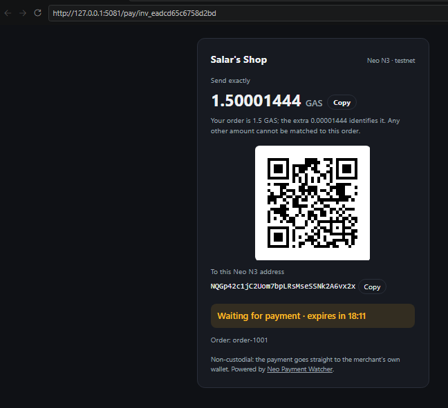
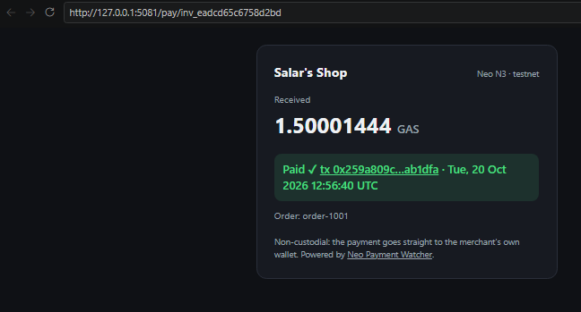

# Neo Payment Watcher

Watch-only payment detection for **Neo N3** and, over standard JSON-RPC, **Neo X, X Layer, Base and any other EVM chain**. It follows the chain, detects incoming token transfers (GAS, NEO, USDT, USDC, the chain's own coin, or any token you whitelist) to your addresses, matches them to orders by unique amount, and calls your webhook. It never holds keys or funds: payments go straight to your own wallet.

- .NET 10, SQLite, plain JSON-RPC to any public node; one NuGet dependency (`Microsoft.Data.Sqlite`).
- Runs anywhere .NET runs (tested on Windows Server 2025), no node or Docker required.
- Exactly-once bookkeeping per block, signed webhooks with retries, invoice API with NEP-9 payment URIs.
- A hosted checkout page per invoice (amount, QR code, live status), so a shop can take Neo payments with no frontend work.

## How it works

1. **Follow blocks.** On Neo N3, read every transaction's application log (`getblock`, `getapplicationlog`). On an EVM chain, read the block with its transactions (`eth_getBlockByNumber`) for payments in the chain's own coin, and the block's `Transfer` logs (`eth_getLogs`) for ERC-20 tokens. dBFT chains (Neo N3, Neo X) have one-block finality, so there the watcher runs at the tip; on chains that can reorganise it stays `Confirmations` blocks behind.
2. **Keep only real payments.** On Neo N3 a notification counts when the execution ended in `HALT`, the event is `Transfer` with exactly three arguments (NEP-17, not NEP-11), the contract is on your token whitelist, and the recipient is a watched address. On an EVM chain a log counts when it is a three-topic `Transfer` from a whitelisted token to a watched address, and a native-coin transaction counts when its receipt says it succeeded. Mints, burns, self-transfers and zero amounts are ignored. The whitelist matters: anyone can deploy a contract that emits `Transfer`.
3. **Match orders by amount.** `POST /invoices` for 1.5 GAS returns a unique amount such as `1.50007883 GAS`. The offset is random, at most 0.01 of the token, and never shared with another open invoice. When exactly that amount arrives before expiry, the invoice is paid. Expired amounts stay reserved for a cooldown so a late payment cannot settle a newer order.
4. **Commit atomically.** A block's transfers, invoice updates, webhook events and the scan checkpoint are written in one SQLite transaction. After a crash the watcher resumes from the last committed block, and re-processing a block changes nothing.
5. **Notify.** Webhooks are delivered from a database outbox with exponential backoff (5 s, 10 s, 20 s … capped at 1 h), signed with HMAC-SHA256.

## Quick start

Requires the [.NET 10 SDK](https://dotnet.microsoft.com/download).

Create `src/NeoPaymentWatcher/appsettings.Local.json` (git-ignored):

```json
{
  "Watcher": {
    "Network": "testnet",
    "Addresses": [ "<your Neo N3 receiving address>" ],
    "Webhook": { "Url": "https://shop.example/neo-webhook", "Secret": "<random secret>" },
    "ApiKey": "<random key>"
  }
}
```

Run it:

```
dotnet run --project src/NeoPaymentWatcher
```

Output from a mainnet replay starting at block 13746549 (`"StartHeight": 13746549`):

```
info: Watching Nec6R8h1VU1FSBYDcnKNDPm3AwUkaUjc6u on mainnet for NEO (0xef4073a0f2b305a38ec4050e4d3d28bc40ea63f5), GAS (0xd2a4cff31913016155e38e474a2c06d08be276cf)
info: Scanning mainnet from block 13746549 (tip 13746827)
info: Received 2039.57997308 GAS at Nec6R8h1VU1FSBYDcnKNDPm3AwUkaUjc6u from NY6HgPkxWPBEiKaC8HSo1PhjXATEiuAdEB in block 13746549 (tx 0x99a9a8bdfa53457dc2d0f71d3c296bb277fea5ac78fab8560783d03528b63597)
```

End to end on testnet (3 Oct 2026): an order for 1 GAS got the unique amount `1.00002098`. The payment, sent from NeoLine, landed in block 19898561, and the signed `invoice.paid` webhook was delivered 2.7 seconds after the block ([transaction](https://dora.coz.io/transaction/neo3/testnet/0x84bea723bc3100affa007b8b6b58a5ace094f3585cc0a7e6b5e1f1056089f42c)):

```
info: Received 1.00002098 GAS at NQGp42c1jC2Uom7bpLRsMseSSNk2A6vx2x from NWf1NLqnUEe55eq4TW3V1DwUhhhzJfrDTe in block 19898561 (tx 0x84bea723bc3100affa007b8b6b58a5ace094f3585cc0a7e6b5e1f1056089f42c), paid invoice inv_08d735fe38e39f03
```

The checkout page, end to end on testnet (20 Oct 2026): invoice `inv_eadcd65c6758d2bd` for 1.5 GAS got the unique amount `1.50001444`; the customer opened `/pay/inv_eadcd65c6758d2bd`, scanned the address and paid from NeoLine; the transfer landed in block 20343628 ([transaction](https://dora.coz.io/transaction/neo3/testnet/0x259a809cd59508997c1cce962805a07936f3c7a0284085e86977136d20ab1dfa)) and the page flipped to **Paid** on its next poll:

```
info: Received 1.50001444 GAS at NQGp42c1jC2Uom7bpLRsMseSSNk2A6vx2x from NWf1NLqnUEe55eq4TW3V1DwUhhhzJfrDTe in block 20343628 (tx 0x259a809cd59508997c1cce962805a07936f3c7a0284085e86977136d20ab1dfa), paid invoice inv_eadcd65c6758d2bd
```

The same service on **Neo X** (`"Chain": "evm"`, `"Network": "neox-mainnet"`), replaying mainnet block 8068890 (21 Oct 2026):

```
info: Watching 0xd2dd7b597fd2435b6db61ddf48544fd931e6869f on Neo X · mainnet for GAS (native)
info: Scanning Neo X · mainnet from block 8068890 (tip 8069160, 0 confirmations)
info: Received 116.993864 GAS at 0xd2dd7b597fd2435b6db61ddf48544fd931e6869f from 0x62b6e27213824c6a2b983c018377d9bd0fdc5e17 in block 8068890 (tx 0x5838ee781d75fc76eab5b7d7234a1fb9c912e0fb8948525f35a7be161a391d98)
```

An invoice for 1.5 GAS on that chain got the unique amount `1.50009109` and the link `ethereum:0xd2dd7b597fd2435b6db61ddf48544fd931e6869f@47763?value=1500091090000000000`.

For mainnet set `"Network": "mainnet"` and a separate `DatabasePath`. Each network has public nodes built in; `RpcUrls` overrides them. At startup the watcher checks the node's network and refuses to mix networks in one database.

Every setting can also come from environment variables, e.g. `Watcher__Addresses__0=N...`.

## Chains

One instance watches one network. `Network` picks it; the chain's id, coin, public nodes and explorer come with the preset:

| `Chain` | `Network` | Coin | Confirmations | Explorer |
| --- | --- | --- | --- | --- |
| `neo-n3` | `mainnet`, `testnet` | GAS, NEO | 0 (dBFT) | Dora |
| `evm` | `neox-mainnet`, `neox-testnet` | GAS (18 decimals) | 0 (dBFT) | xexplorer.neo.org / xt4scan |
| `evm` | `xlayer-mainnet`, `xlayer-testnet` | OKB | 2 | OKLink |
| `evm` | `base-mainnet`, `base-sepolia` | ETH | 6 | Basescan |
| `evm` | `custom` | `NativeSymbol` | `Confirmations` | `ExplorerTx` |

A Neo X configuration that accepts GAS:

```json
{
  "Watcher": {
    "Chain": "evm",
    "Network": "neox-testnet",
    "Addresses": [ "0x<your Neo X address>" ]
  }
}
```

Add ERC-20 tokens by contract address in `Tokens`, e.g. USDC on Base (`0x833589fcd6edb6e08f4c7c32d4f71b54bda02913`); symbol and decimals are read from the contract. `WatchNative: false` turns the chain's own coin off. Any other EVM chain works with `"Network": "custom"` plus `ChainId`, `RpcUrls`, and optionally `ChainName`, `NativeSymbol` and `ExplorerTx`.

What to know on EVM chains:

- **Only direct payments count.** A transfer of the chain's own coin made *by a contract* (an "internal transfer", e.g. from a smart-contract wallet) is not in the block's transaction list and is not detected; ERC-20 transfers are detected whoever sends them. Customers paying from a normal wallet are always seen.
- **Confirmations.** `Confirmations` is how many blocks the watcher stays behind the tip. Neo X is dBFT and needs none. On Base and X Layer the sequencer practically never reorganises, so the defaults are small; raise them for large tickets.
- **Amounts stay readable.** For 18-decimal coins the unique offset moves in 8-decimal steps, so a customer sees `1.50001234 GAS`, not eighteen digits.
- **Payment links** in `paymentUri` follow [EIP-681](https://eips.ethereum.org/EIPS/eip-681) (`ethereum:<address>@<chainId>?value=...`, or `/transfer` for a token). Wallet support for prefilled amounts varies, so the checkout page's QR code holds the plain address unless `Checkout:QrContent` is `uri`.
- **Calls per block:** one for the block, one for the logs when tokens are configured, and one receipt per candidate native payment. At one-second blocks that fits inside public rate limits, with one exception: Base's own node (`mainnet.base.org`) throttles `eth_getLogs`, so the preset tries a second public node first. For production, put your own or a keyed endpoint in `RpcUrls`.

## HTTP API

Listens on `http://127.0.0.1:5080` by default. When `Watcher:ApiKey` is set, every endpoint except `/health` and the checkout page requires the `X-Api-Key` header.

| Method | Path | Purpose |
| --- | --- | --- |
| `POST` | `/invoices` | Create an invoice: `{"token": "GAS", "amount": "1.5", "reference": "order-1001", "ttlMinutes": 15}`. `address` is optional (defaults to the first watched address). |
| `GET` | `/invoices/{id}` | Invoice status: `pending`, `paid` or `expired`. |
| `GET` | `/transfers?limit=50` | Latest incoming transfers. |
| `GET` | `/health` | Chain, network, chain tip, last processed block. |
| `GET` | `/pay/{id}` | The checkout page for an invoice (see below). No API key. |
| `GET` | `/pay/{id}/status` | What the page polls: `status`, `paidTxId`, `paidAt`, `expiresAt`, `explorerUrl`. No API key. |

Response from `POST /invoices`:

```json
{
  "id": "inv_55a0b177a274926e",
  "status": "pending",
  "address": "Nec6R8h1VU1FSBYDcnKNDPm3AwUkaUjc6u",
  "token": { "symbol": "GAS", "hash": "0xd2a4cff31913016155e38e474a2c06d08be276cf", "decimals": 8 },
  "amount": "1.50007883",
  "amountUnits": "150007883",
  "requestedAmount": "1.5",
  "reference": "order-1001",
  "createdAt": "2026-10-03T15:05:23.026+00:00",
  "expiresAt": "2026-10-03T15:20:23.026+00:00",
  "paidTxId": null,
  "paidAt": null,
  "paymentUri": "neo:Nec6R8h1VU1FSBYDcnKNDPm3AwUkaUjc6u?asset=gas&amount=1.50007883",
  "checkoutUrl": "https://pay.example.com/pay/inv_55a0b177a274926e"
}
```

Send the customer to `checkoutUrl`, or show them `amount` yourself (or a QR code of `paymentUri`); they must send exactly that amount. `checkoutUrl` is `null` until `Checkout:PublicBaseUrl` is set. NEO has no decimals, so it cannot be used for unique-amount invoices; its transfers are still reported. On an EVM chain the token can be `native` for the chain's own coin, or its symbol (`GAS`, `USDC`).

## Checkout page

`GET /pay/{id}` is a payment page the shop links its customer to:

- The exact amount with a copy button, the receiving address with a copy button, and a QR code of the address (or of the NEP-9 link, with `Checkout:QrContent` set to `uri`, for wallets that prefill the amount from it).
- A status line that counts down to expiry, then flips to **Paid** with a link to the transaction on [Dora](https://dora.coz.io) the moment the watcher sees the transfer. The page polls `/pay/{id}/status` every 3 seconds, one block; without JavaScript it reloads every 10 seconds instead.
- One HTML document with no external resources: no fonts, scripts or images are fetched from anywhere, so nothing about the customer leaks to a third party, and it works behind any firewall. The QR code is generated in the service (byte mode, error correction level M) rather than by a graphics library.
- Public on purpose, so that customers need no key: the invoice id (64 random bits) is the only secret, the page shows nothing but that invoice, and it is sent with `Cache-Control: no-store`, `Referrer-Policy: no-referrer` and a Content-Security-Policy.

Set `Checkout:PublicBaseUrl` to the origin customers reach the service on (behind TLS), and `Checkout:Title` to the shop's name.

The testnet invoice of 20 Oct 2026, before and after the customer paid it from NeoLine (the wallet's confirmation is in [docs/checkout-neoline.png](docs/checkout-neoline.png)):




## Webhooks

`POST` to `Watcher:Webhook:Url` with:

- `X-Event-Id`: `<txid>:<notification index>`, unique per transfer. Delivery is at-least-once, so de-duplicate on it.
- `X-Signature`: `sha256=<hex HMAC-SHA256 of the raw body>`, when `Webhook:Secret` is set.

`type` is `invoice.paid` when the transfer settled an invoice, else `transfer.received`. This payload was produced by replaying mainnet block 13746549:

```json
{
  "id": "0x99a9a8bdfa53457dc2d0f71d3c296bb277fea5ac78fab8560783d03528b63597:0",
  "type": "transfer.received",
  "chain": "neo-n3",
  "network": "mainnet",
  "transfer": {
    "txId": "0x99a9a8bdfa53457dc2d0f71d3c296bb277fea5ac78fab8560783d03528b63597",
    "notifyIndex": 0,
    "blockIndex": 13746549,
    "blockTime": "2026-10-03T14:50:31.247+00:00",
    "token": { "symbol": "GAS", "hash": "0xd2a4cff31913016155e38e474a2c06d08be276cf", "decimals": 8 },
    "from": "NY6HgPkxWPBEiKaC8HSo1PhjXATEiuAdEB",
    "to": "Nec6R8h1VU1FSBYDcnKNDPm3AwUkaUjc6u",
    "amount": "2039.57997308",
    "amountUnits": "203957997308",
    "invoiceId": null
  },
  "invoice": null
}
```

Verifying the signature in C#:

```csharp
var expected = "sha256=" + Convert.ToHexStringLower(HMACSHA256.HashData(Encoding.UTF8.GetBytes(secret), rawBody));
var valid = CryptographicOperations.FixedTimeEquals(Encoding.ASCII.GetBytes(expected), Encoding.ASCII.GetBytes(signatureHeader));
```

## Configuration

All settings live under `Watcher`.

| Setting | Default | Meaning |
| --- | --- | --- |
| `Chain` | `neo-n3` | `neo-n3` or `evm`. |
| `Network` | `testnet` | A preset from the Chains table, or `custom`; checked against the node at startup. |
| `ChainId`, `ChainName`, `NativeSymbol`, `ExplorerTx` | from the preset | For a custom EVM chain: its id (required), display name, coin symbol and a transaction URL template with `{tx}`. |
| `Confirmations` | from the preset | Blocks to stay behind the tip on chains that can reorganise. |
| `RpcUrls` | the preset's public nodes | JSON-RPC endpoints; the next one is used when a call fails. Neo N3 nodes need the ApplicationLogs plugin (public nodes have it). |
| `Addresses` | (required) | Receiving addresses to watch. |
| `Tokens` | NEO and GAS, or the native coin | Token contracts to accept: NEP-17 hashes on Neo N3, ERC-20 addresses on an EVM chain. Symbol and decimals are read from chain. |
| `WatchNative` | `true` | EVM only: also accept the chain's own coin. |
| `StartHeight` | chain tip | Block to start from on the first run; later runs resume from the database. |
| `PollIntervalMs` | `1000` | Delay between polls once caught up (blocks are 3 s apart). |
| `DatabasePath` | `watcher-testnet.db` | SQLite file. Use one per network. |
| `ApiKey` | empty | Required `X-Api-Key` value for the API when set. |
| `Webhook:Url` / `Secret` / `MaxAttempts` | empty / empty / `12` | Event delivery. |
| `Invoices:DefaultTtlMinutes` | `30` | Invoice lifetime. |
| `Invoices:MaxOffsetUnits` | `9999` | Largest unique-amount offset, in base units (or 8-decimal steps for 18-decimal coins), capped at 1% of one token. |
| `Invoices:ReuseCooldownMinutes` | `60` | How long an expired invoice's amount stays reserved. |
| `Checkout:Enabled` | `true` | Serve the checkout page at `/pay/{id}`. |
| `Checkout:PublicBaseUrl` | empty | Public origin of the service, e.g. `https://pay.example.com`; gives invoices their `checkoutUrl`. |
| `Checkout:Title` | `Payment` | Heading of the page, e.g. the shop's name. |
| `Checkout:QrContent` | `address` | `address` (any wallet can scan it) or `uri` (the NEP-9 link; prefills the amount in wallets that support it). |

## Security notes

- Watch-only: the service only needs public addresses. Keep your keys in your wallet.
- The API binds to localhost by default. Set `ApiKey` and put TLS in front before exposing it. The checkout page is meant to be public; everything else stays behind the key.
- Only whitelisted token contracts count as payment; verify contract hashes before adding tokens.
- Treat a webhook as a trigger and confirm with `GET /invoices/{id}` if your receiver cannot verify signatures.

## Development

```
dotnet test
```

The tests cover address encoding, amount maths, transfer parsing against real mainnet notifications (including NEP-11, mints, failed transactions and fake tokens), EVM log and transaction parsing, chain presets and payment links, invoice matching, expiry, idempotent block commits, webhook retry scheduling, the checkout page and the QR encoder (whose output was also decoded back with jsQR for every symbol version).

## License

MIT
